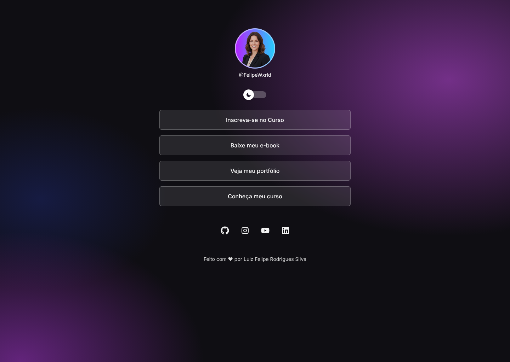

# DevLinks

Página de links pessoais de Luiz Felipe Rodrigues Silva ([@FelipeWxrld](https://github.com/FelipeWxrld)), feita em **React + Vite**, baseada no layout "DevLinks • OpenCode MiniProject" do Figma. Tem modo claro e escuro, e a escolha fica salva no navegador.




## Tecnologias
- React 19
- Vite
- CSS puro (variáveis CSS para os temas)
- Playwright (testes e capturas de tela)
- Desenvolvido com apoio de IA (OpenCode/Claude), Context7 e Playwright MCP, guiado pelo [`AGENTS.md`](AGENTS.md)

## Como instalar e executar
```bash
npm install
npm run dev       # abre em http://localhost:5173
```

Outros comandos:
```bash
npm run build     # gera a versão de produção em dist/
npm run preview   # serve a versão de produção
npx playwright install chromium   # só na primeira vez, para os testes
npm test          # testes com Playwright (desktop e mobile)
npm run screenshots   # gera as capturas em docs/screenshots/
```

## Funcionalidades
- Avatar, @usuário, 4 botões de link e 4 redes sociais
- Links externos abrem em nova aba
- Alternância entre modo claro e escuro, salva em `localStorage`
- Avatar com óculos escuros no tema claro (camada SVG sobre a foto) e sem óculos no escuro, como no Figma
- Layout responsivo (mobile e desktop)

## Fidelidade ao Figma
As medidas seguem os frames do Figma: desktop 1440×1024 (conteúdo de 540px) e mobile 360×800 (margem de 24px), avatar de 114px, botões de 56px de altura com 16px de espaço entre eles, fonte Inter e ícones sociais de 24px. As capturas em `docs/screenshots/` usam esses mesmos tamanhos.

## Componentes
| Componente | Props | Função |
| --- | --- | --- |
| `Profile` | `avatar`, `username`, `sunglasses` | Foto, óculos (tema claro) e @usuário |
| `ThemeToggle` | `theme`, `onToggle` | Interruptor de tema |
| `LinkButton` | `label`, `url` | Botão de link |
| `SocialLinks` | `items` | Ícones das redes (usa `map()`) |
| `Footer` | `name` | Rodapé |

O estado do tema (`useState`) e o `localStorage` ficam em `src/hooks/useTheme.js`.

## Como personalizar
Edite `src/data/profile.js` (nome, @usuário, links e redes). Para trocar a foto, substitua `public/avatar.png` (recorte quadrado). Se os óculos não ficarem sobre os olhos, ajuste `left`, `top` e `width` em `.profile__sunglasses` no `src/index.css`.

## Evidências
Veja [`docs/EVIDENCIAS.md`](docs/EVIDENCIAS.md) para o uso de Context7 e Playwright.
