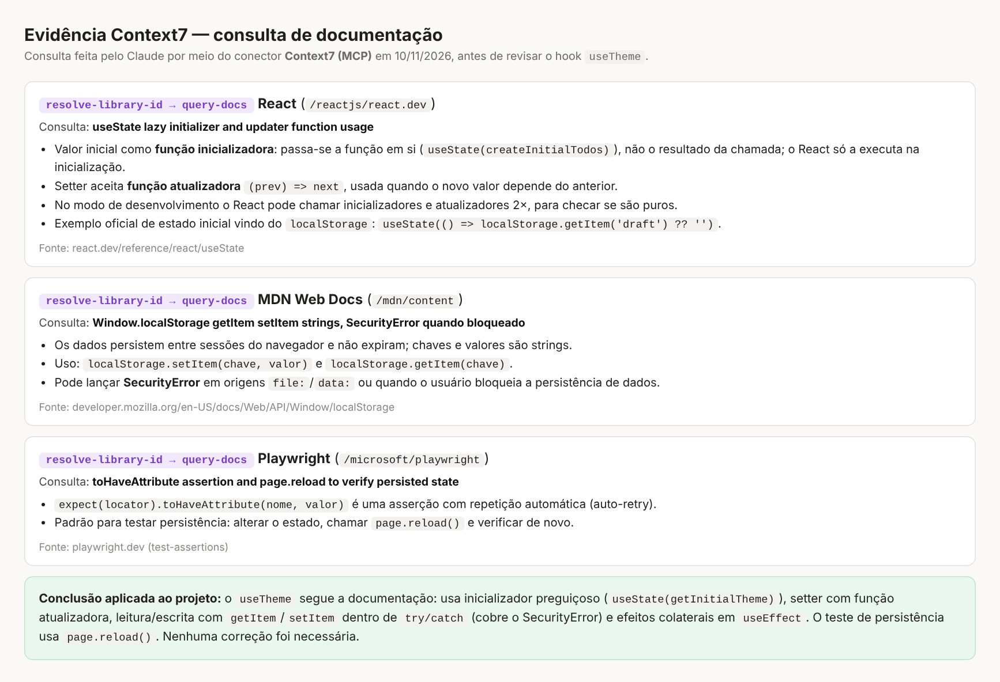
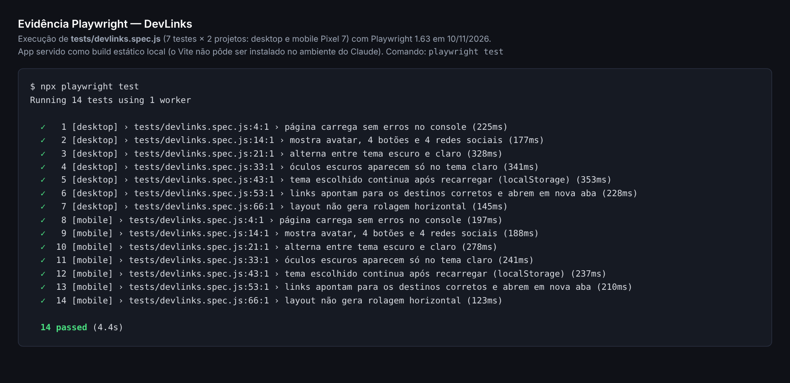

# Evidências de uso de Context7 e Playwright

## 1. Context7 (consulta de documentação)

Antes de revisar o hook `useTheme`, a documentação foi consultada por meio do **Context7 (MCP)**, usando as ferramentas `resolve-library-id` e `query-docs`:

| Biblioteca (ID no Context7) | Pergunta feita | O que a documentação confirmou |
| --- | --- | --- |
| React (`/reactjs/react.dev`) | `useState` com função inicializadora e função atualizadora | Passar a função em si (`useState(fn)`) a executa só na inicialização; o setter aceita `(prev) => next` |
| MDN (`/mdn/content`) | `localStorage` com `getItem`/`setItem` e `SecurityError` | Valores são strings, os dados persistem entre sessões e o acesso pode lançar `SecurityError` se o armazenamento estiver bloqueado |
| Playwright (`/microsoft/playwright`) | `toHaveAttribute` e `page.reload()` | Asserção com repetição automática; padrão de recarregar a página para testar persistência |

**Resultado:** o `useTheme` já seguia essas recomendações (inicializador preguiçoso, setter com função atualizadora, `getItem`/`setItem` dentro de `try/catch` e efeitos colaterais no `useEffect`). Nenhuma correção foi necessária.

> Nota: a imagem acima é um resumo gerado a partir das respostas reais do Context7 (feito pelo agente de IA durante o desenvolvimento). Se preferir, substitua por um print direto da conversa com o agente.

## 2. Playwright

Os 7 testes de `tests/devlinks.spec.js` rodaram nos projetos **desktop** e **mobile (Pixel 7)**: **14 testes passaram**.

> Nota: nessa execução o app foi servido como build estático local, porque o Vite não pôde ser instalado no ambiente do agente. Na sua máquina, rode `npx playwright install chromium` e `npm test` para repetir com o servidor do Vite.

Os testes cobrem a checklist do enunciado:

- [x] Página carrega sem erro (sem erros no console)
- [x] Tema claro e escuro funcionam (e os óculos do avatar aparecem só no claro)
- [x] Tema continua após recarregar (`localStorage` + `page.reload()`)
- [x] Links apontam para os destinos corretos e abrem em nova aba
- [x] Layout funciona em celular e desktop (sem rolagem horizontal)
- [ ] Resultado visual comparado com o Figma (conferência manual: veja as capturas abaixo)

## 3. Capturas de tela

Geradas com `npm run screenshots`:

| | Escuro | Claro |
| --- | --- | --- |
| Desktop | `screenshots/desktop-dark.png` | `screenshots/desktop-light.png` |
| Mobile | `screenshots/mobile-dark.png` | `screenshots/mobile-light.png` |
